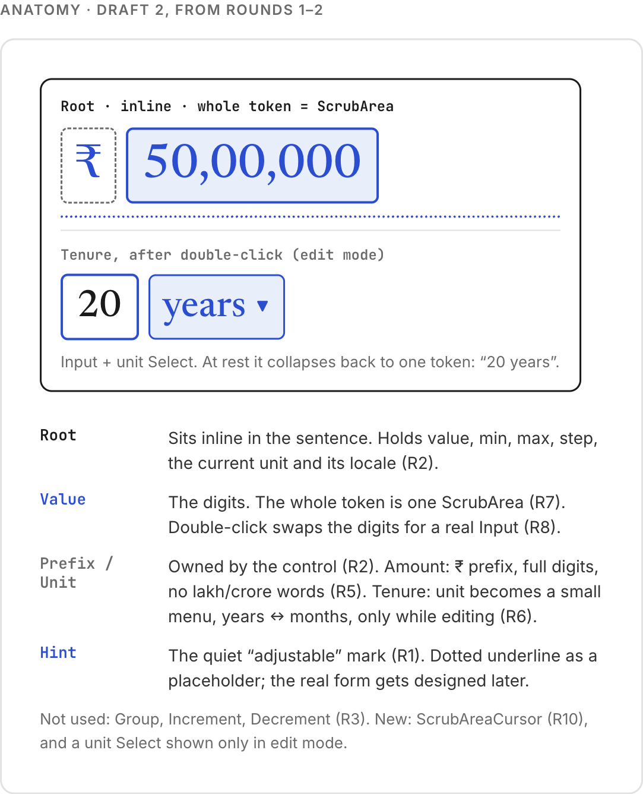

# Iteration log

A running record of how the essay and its components changed, and why. It is raw material for a case study, so each entry keeps what we tried, what we learned and what we decided, including dead ends.

Newest entries go at the bottom. Each one follows the same shape:

- **Tried:** what we made or asked
- **Learned:** what the attempt showed
- **Decided:** what changed as a result
- **Evidence:** commits, board snapshots, links

## Try them in Storybook

Every component iteration is frozen in Storybook under **Iterations/**, so you can try each version as it was. Open the **Docs** page to see them all on one page. The live component, which keeps changing, is under **Essay/**.

| Iteration | Story | Log entry |
|---|---|---|
| Scrubbable number 01 · P3 first build | `Iterations/Scrubbable number/01 · P3 first build` | 7 |
| Scrubbable number 02 · Drag cursor, pickable values | `Iterations/Scrubbable number/02 · Drag cursor, pickable values` | 8 |

How a snapshot is made: when an iteration closes, copy the component into `src/iterations/<component>/<nn-name>/`, rename its CSS classes with a version prefix (`sn02-`) so versions don't clash on one page, mark it frozen, and add a story. Snapshot 01 was rebuilt after the fact by reversing the R10 changes, because the first commit already included them.

---

## 1 · Framing the essay · 2026-11-18

**Tried:** We started from one sentence: interest is front-loaded, and small regular prepayments shorten a home loan a lot. The V1 scope: three scrubbable inputs, live outputs, one principal vs interest chart, both prepayment strategies, a public URL and a 15-second recording.

**Decided:**
- Indian context throughout: ₹ formatting and current Indian rates. The default rate is 7.5%; the first guess of 8.5% was corrected once current bank rates were checked.
- Both prepayment strategies are in V1: one extra EMI a year, and raising the EMI 5% a year.
- The essay is the first user of the Base UI design system. Components move into the system after the essay ships.
- Presentation details get decided while building, not up front.

**Evidence:** [brief](../product/brief.md), commit `8d6524f`.

## 2 · Research: what borrowers actually say · 2026-11-18

**Tried:** Read r/personalfinanceindia to find the voice and the real worries.

**Learned:**
- Reddit blocks direct crawling. We used Firecrawl search excerpts instead and didn't work around the block.
- The community's own numbers back up the thesis. One borrower took ₹58L at 7.25% and after 2 years had paid about ₹8L interest and ₹2.5L principal; our model gives ₹8.2L and ₹2.8L.
- The community's folk rule is both strategies at once: "increasing your emi by 5 percent every year and paying one extra installment every year".
- Two forces sit outside the spreadsheet: family pressure to own a home, and the 2026 layoffs.

**Decided:** Quotes are excerpts only, with no usernames, and link to the thread. Each one gets checked against the full thread before publishing.

**Evidence:** [community themes](../research/2026-11-18-community-themes.md).

## 3 · Essay drafts 1 → 2 · 2026-11-18

**Tried:** A first prose draft as an HTML review page with sliders, so the reactive copy could be checked at any input.

**Learned:**
- The voice worked. The headline line became "EMI will be very comfortable".
- A joke that holds at ₹50 lakh can break at ₹10 lakh for 5 years. Conditional copy has to be tested across the input range, not at the default.

**Decided:** Draft 2 added real r/PFI quotes, the house as a family milestone ("the spreadsheet doesn't come to Sunday lunch"), and a 2026 layoffs beat with a six-EMI cushion. An animated cards view for the quotes is deferred to SID-9.

**Evidence:** [draft 2](../drafts/2026-11-18-essay-draft.html), commit `e0f83cf`.

## 4 · Choosing a thinking tool · 2026-11-18

**Tried:** An interactive Q&A canvas in tldraw for thinking through the first component: Claude asks, the designer answers on the canvas, Claude follows up.

**Learned:** The tldraw connector could write to the canvas but couldn't read it back, so answers never reached the conversation.

**Decided:** We moved the Q&A to Paper. Question cards sit next to yellow answer boxes. The designer types an answer and says "next". Answers turn green when resolved, blue when they open new questions, and grey when parked.

## 5 · Scrubbable number, anatomy round 1 · 2026-11-18

**Tried:** Six questions about what a draggable number in a sentence is made of: what shows at rest, what you grab, who owns the unit, how you type a value, stepper buttons, and what shows while dragging. Each was mapped to Base UI NumberField parts.

**Decided:**
- R1: at rest, the value and unit show, plus a quiet hint that it's adjustable.
- R2: the unit belongs to the control, so the control owns its width, formatting and what screen readers announce.
- R3: no − / + buttons inside the sentence. Group, Increment and Decrement aren't used.
- R4: both drag and type, with formatting that follows the currency.
- Parked: a frequency distribution of common loan amounts, shown while dragging.

**Learned:** One answer (A2: "the user should be able to redefine the units") opened a question the board hadn't asked: the unit can change, so it becomes a second interactive part of the token.

## 6 · Anatomy round 2 · 2026-11-18

**Tried:** Four follow-ups from A2: which units switch, how they switch, what you drag, and whether to prototype.

**Pushback:** Switching ₹ ↔ $ would make this a different essay. US loans have different rates and rules. The designer agreed: the component can support any currency, and this essay won't use it.

**Decided:**
- R5: full digits with Indian grouping (₹50,00,000), no lakh/crore words. Tenure switches between years and months.
- R6: the unit menu appears only while editing, so one gesture never means two things.
- R7: you can drag anywhere on the token.
- R8: prototype P3: drag to scrub, double-click to type.
- R9: large numbers move in discrete steps (₹1 lakh), with a strip of common values above the token.
- T1, still to test: a single click that opens the values has to wait about 300 ms to rule out a double-click. Does that feel slow?

**Evidence:**
- 
- [The full board after rounds 1–2](assets/2026-11-18-anatomy-board-rounds-1-2.png)
- [Live Paper board](https://app.paper.design/file/01M7QDS3TP0GN6FKD3YBWFFXVK/p-1-0)

## 7 · Prototype P3 in Storybook · 2026-11-18

**Tried:** An unstyled build of P3 on Base UI NumberField and Select, with four stories: the essay sentence with a live EMI, Amount, Tenure, and PresetsOnClick.

**Learned:**
- Base UI locks the mouse pointer the moment you press on the drag area. That lets a drag continue past the edge of the screen, but it means the browser's own double-click event can't be trusted. The component detects a double-click from two presses close in time and position instead. On the second press it tells Base UI not to start a drag.
- The real input stays mounted but visually hidden at rest, so the keyboard path works without a mouse. Tab focuses it, arrow keys step, and typing a digit or pressing Enter starts editing, like a spreadsheet cell. Esc reverts.

**Decided:** The CSS covers only what the behaviour needs. Visual design comes later, in Paper.

**Evidence:** commit `c96226c`; Storybook `Iterations/Scrubbable number/01`. Interaction tests cover keyboard stepping, typing over a value, Esc reverting, and switching years to months.

## 8 · First hands-on feedback · 2026-11-18

**Tried:** The designer used the prototype.

**Learned:**
- Dragging with no visible pointer felt wrong.
- The values strip only showed the range while dragging; you couldn't pick a value from it.

**Decided:** R10:
- A ↔ cursor is drawn with ScrubAreaCursor while the pointer is locked. Safari doesn't lock the pointer, so it keeps the native cursor across the page during a drag.
- The values strip opens on drag and stays open after release. You can click any value, and it closes on a pick, an outside press, Esc, or double-click.

**Learned along the way:** You can't click anything mid-drag because the pointer is locked to the drag. So "selectable while dragging" became "selectable after the drag".

**Evidence:** Storybook `Iterations/Scrubbable number/02`. A test checks that picking ₹75,00,000 from the strip sets the value, and that a double-click doesn't leave the strip open.

---

## Case-study threads so far

Threads worth pulling on when this becomes a write-up:

- **Answers that open questions.** A2 turned a fixed unit into a second interactive part, and that reshaped the anatomy.
- **Pushback that narrowed scope.** ₹ ↔ $ was dropped from the essay but kept in the component.
- **A platform constraint that drove design.** Pointer lock shaped both the double-click logic and the sticky values strip.
- **Copy as a state space.** Reactive jokes have to hold at every input, not just the default.
- **The thinking tool itself.** tldraw had no read-back, so the Q&A moved to a Paper board.
